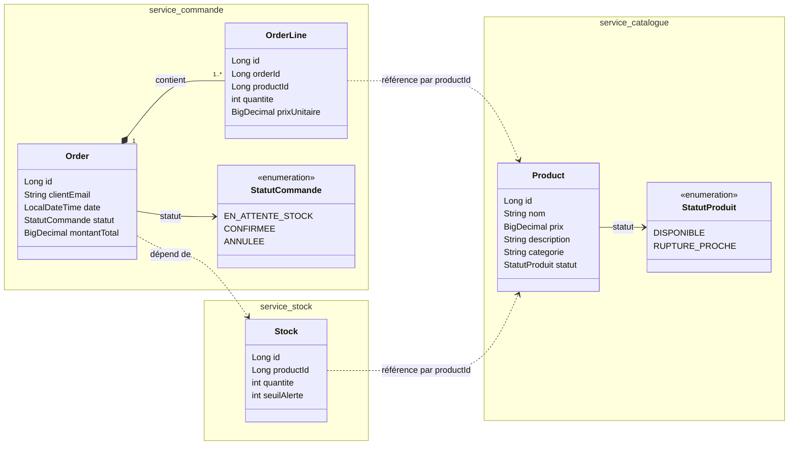
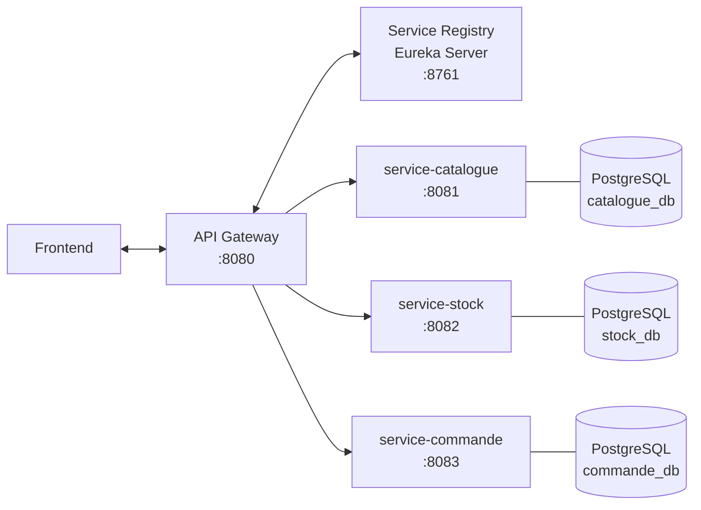

# Commande Express

Projet réalisé dans le cadre du cours J2EE avancé et Spring Boot (EMSI), enseigné par M. KHALIL Salim.

Commande Express est une mini plateforme e-commerce basée sur une architecture microservices. Le client passe une commande, le stock est décrémenté automatiquement à la confirmation, et les produits dont le stock passe sous un seuil d'alerte sont signalés « en rupture proche » dans le catalogue.

L'unité de traitement est la **commande**, dont le cycle de vie est : `EN_ATTENTE_STOCK` → `CONFIRMEE` → `ANNULEE`.

L'application est composée de trois services métier :

- **service-catalogue** : référentiel des produits à la vente
- **service-commande** : passage et cycle de vie des commandes (service principal)
- **service-stock** : suivi des niveaux de stock

Technologies : Java 21, Spring Boot, Maven, Spring Cloud (Eureka, Gateway, OpenFeign), Resilience4j, Kafka.

## Diagramme de classes

## Architecture

| Application | Rôle | Port |
|---|---|---|
| api-gateway | Point d'entrée unique, routage | 8080 |
| eureka-server | Registre des services | 8761 |
| service-catalogue | Référentiel des produits | 8081 |
| service-stock | Niveaux de stock | 8082 |
| service-commande | Cycle de vie des commandes | 8083 |
